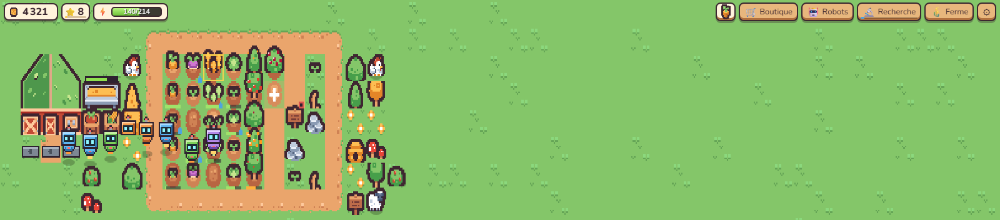
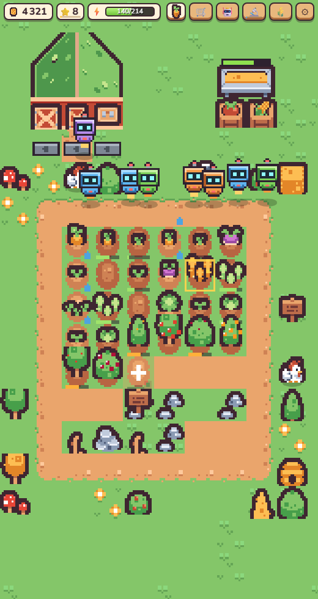
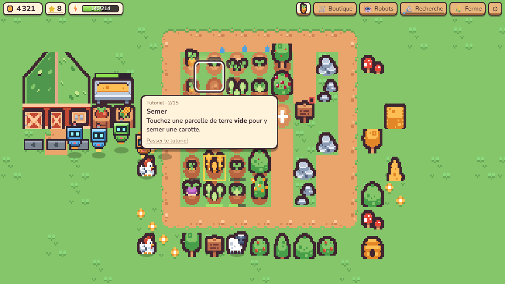
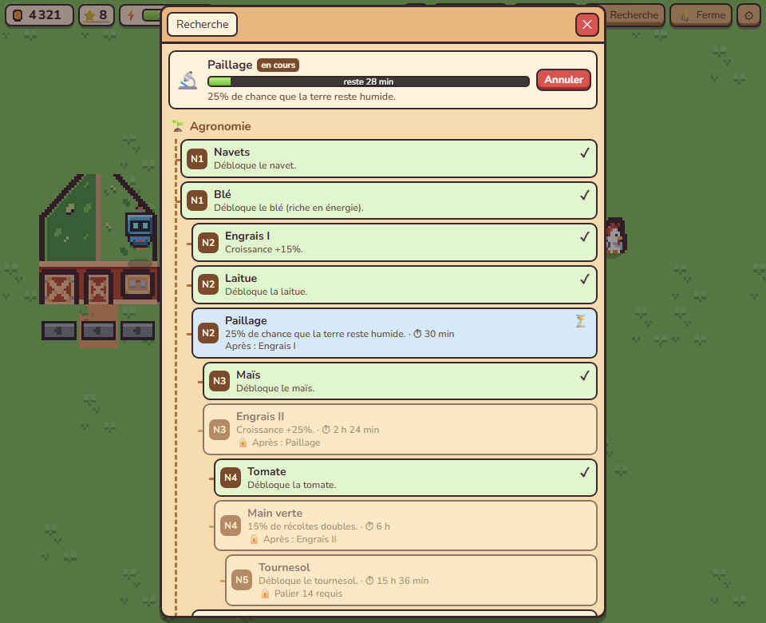
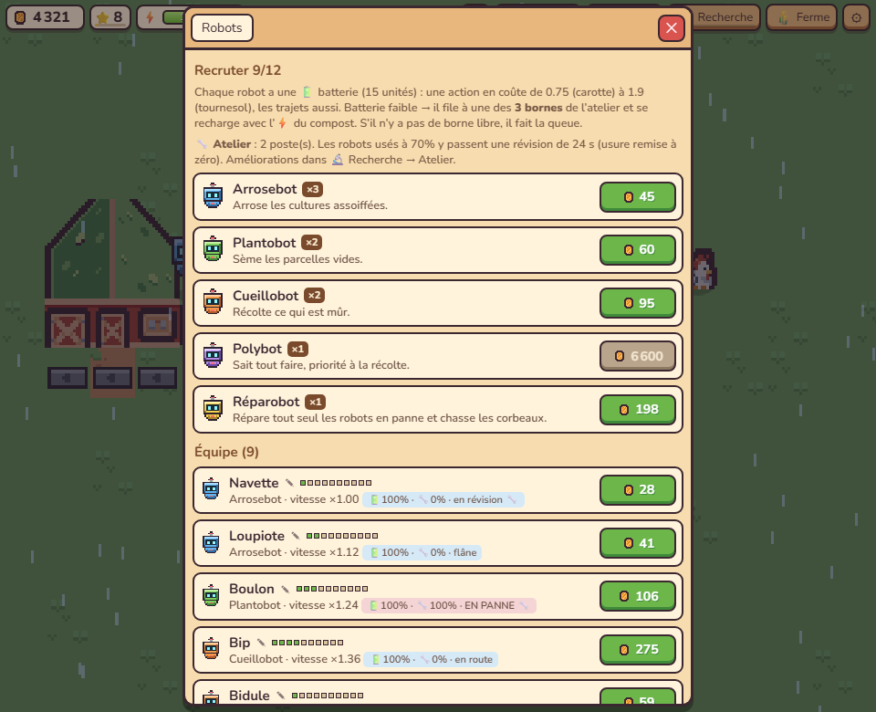
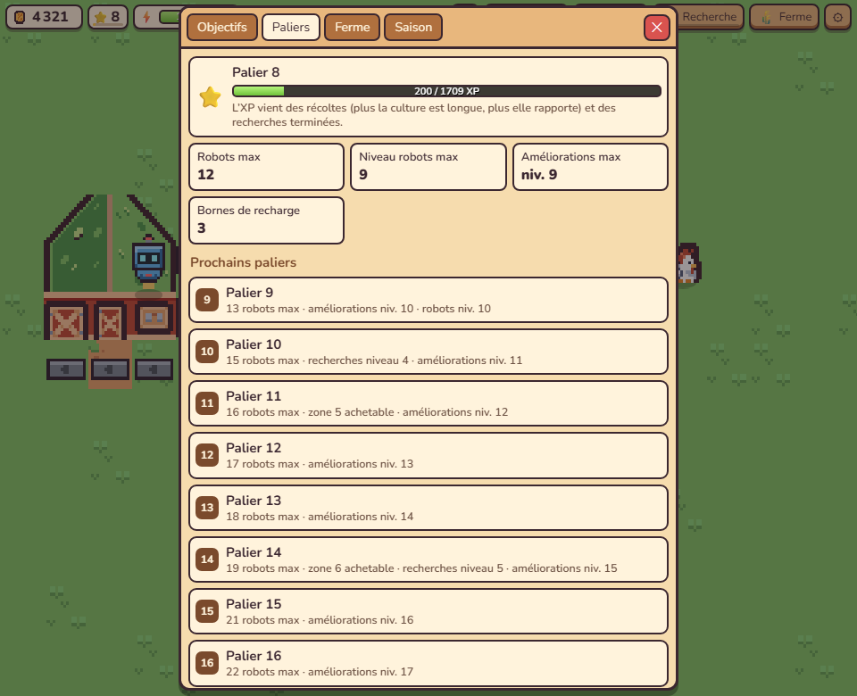
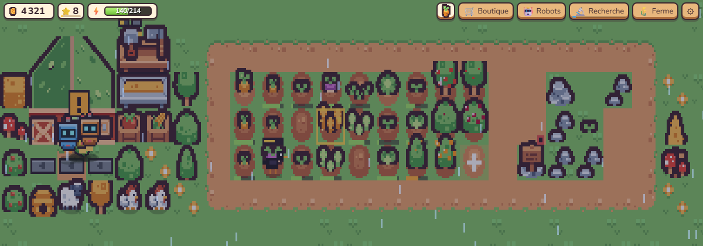
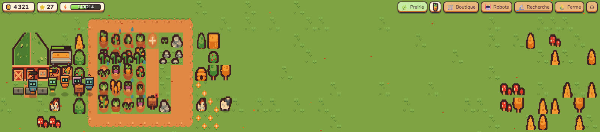

<div align="center">

# 🌱 DeskCosy

**Un petit potager tenu par des robots, qui pousse au bord de votre écran pendant que vous travaillez.**

Jeu *idle* cosy en pixel art · HTML5 / JavaScript sans dépendance · Mode bureau Windows · Paysage **et** portrait

[**▶ Jouer dans le navigateur**](https://bbtoff.github.io/DeskCosy/) · [**🔌 Mode recharge**](https://bbtoff.github.io/DeskCosy/recharge/) · [Démo ferme avancée](https://bbtoff.github.io/DeskCosy/?demo=1) · [Démo Vallée d’automne](https://bbtoff.github.io/DeskCosy/?demo=2)



</div>

---

## Sommaire

- [Le concept](#le-concept)
- [Captures](#captures)
- [Installation et lancement](#installation-et-lancement)
- [Comment jouer](#comment-jouer)
- [Progression et difficulté](#progression-et-difficulté)
- [Fin de partie : la Vallée d’automne](#fin-de-partie--la-vallée-dautomne)
- [Mode recharge (Tesla, tactile)](#mode-recharge-tesla-tactile)
- [Mode bureau](#mode-bureau)
- [Options et accessibilité](#options-et-accessibilité)
- [Structure du projet](#structure-du-projet)
- [Modifier l’équilibrage](#modifier-léquilibrage)
- [Crédits et licences](#crédits-et-licences)

---

## Le concept

DeskCosy est un jeu de ferme qui **tourne tout seul**. Il s’installe sous forme de bande en bas (ou sur le côté) de l’écran,
toujours visible, et avance doucement pendant que vous faites autre chose.

- 🥕 Vous semez, arrosez et récoltez à la main au début…
- 🌳 …puis vous plantez un **verger** : des arbres fruitiers qui redonnent des fruits sans replanter ni arroser.
- 🤖 …puis vous recrutez des **robots** qui s’en chargent : Arrosebot, Plantobot, Cueillobot, Polybot et Réparobot.
- 🔋 Les robots **se fatiguent** et vont se recharger sur des bornes, avec l’énergie produite par le **compost**.
- 🔧 Des **imprévus** : pannes, orages qui coupent le courant, corbeaux qui picorent les récoltes.
- 🔬 Un **arbre de recherche** en temps réel, des **paliers**, des **zones** de terrain à acheter.
- 🍂 Une **seconde ferme** de fin de partie, plus exigeante.
- 🌙 Jour et nuit selon l’heure réelle, pluie, cadeaux, cultures dorées, animaux à câliner.
- ⏳ Progression **hors-ligne** : vos robots continuent de travailler pendant votre absence (jusqu’à 12 h).

Durée de vie mesurée avec un joueur automatique qui optimise tout : **≈ 200 h** pour tout terminer en profitant des
**nouvelles saisons** (prestige), et ≈ 350 h sans. Comptez davantage en jouant normalement.

---

## Captures

| Bande verticale (portrait) | Tutoriel interactif |
|:---:|:---:|
|  |  |

| Arbre de recherche | Robots et batteries | Paliers |
|:---:|:---:|:---:|
|  |  |  |

**Imprévus et verger** : un robot en panne (clé 🔧), un corbeau, un orage qui coupe les bornes, l’atelier de réparation
au-dessus du compost et les arbres fruitiers :



**La Vallée d’automne** (fin de partie) :



---

## Installation et lancement

### Dans le navigateur (PC, tablette, téléphone)

- En ligne : **https://bbtoff.github.io/DeskCosy/**
- En local : téléchargez le projet et ouvrez `index.html`.

La sauvegarde est stockée dans le navigateur (`localStorage`).

### Mode bureau (Windows)

Prérequis : [Python 3](https://www.python.org/) (le module `pywebview` s’installe automatiquement au premier lancement).

```bat
git clone https://github.com/bbtoff/DeskCosy.git
cd DeskCosy
"Lancer DeskCosy.bat"
```

Le jeu s’ouvre en **bande sans bordure, toujours au premier plan**, ancrée en bas de l’écran au-dessus de la barre des tâches.
La sauvegarde est dans `%APPDATA%\DeskCosy\save.json`.

---

## Comment jouer

| Action | Effet |
|---|---|
| **Toucher une parcelle** | semer → arroser (goutte bleue) → récolter |
| **Clic droit / appui long** sur une parcelle | lui attribuer la graine choisie (les robots la replanteront) |
| Bouton **graine** en haut | choisir la culture à planter |
| **+** dans le champ | acheter une parcelle |
| Panneau **🔒** au bout du champ | acheter la zone suivante |
| **Molette** | zoom |
| Cliquer un robot / un animal | 💛 |
| Cadeau dans l’herbe | pièces ou batterie pleine |

Les récoltes sont en partie **vendues** (pièces) et en partie **compostées** (⚡ énergie des robots).
Le curseur de répartition est dans **Ferme**.

Un **tutoriel interactif** guide les premières minutes (on peut le revoir dans ⚙ Options).

### Cultures

| | Culture | Pousse | Vente | Énergie | Débloquée par |
|:---:|---|---:|---:|---:|---|
| 🥕 | Carotte | 20 s | 4 | 3 | — |
| 🟣 | Navet | 36 s | 7 | 3 | recherche |
| 🌾 | Blé | 45 s | 6 | 9 | recherche |
| 🥬 | Laitue | 1 min 10 | 18 | 6 | recherche |
| 🌽 | Maïs | 1 min 50 | 40 | 16 | recherche |
| 🍅 | Tomate | 2 min 50 | 85 | 14 | recherche |
| 🌻 | Tournesol | 4 min 20 | 210 | 45 | recherche |

**Arbres fruitiers** : plantés une fois, ils mettent du temps à pousser puis donnent des fruits en continu, sans être
replantés ni arrosés (une seule action par récolte pour les robots).

| | Arbre | Première récolte | Puis fruits toutes les | Vente | Énergie |
|:---:|---|---:|---:|---:|---:|
| 🍎 | Pommier | 6 min | 2 min | 55 | 10 |
| 🍒 | Cerisier | 10 min | 3 min | 130 | 22 |
| 🍊 | Oranger | 15 min | 4 min | 330 | 50 |
| 🌰 | Noyer doré | 25 min | 6 min | 900 | 120 |

---

## Progression et difficulté

- **🔋 Fatigue des robots** : chaque action et chaque trajet vident la batterie. Les grosses cultures fatiguent davantage
  (un tournesol coûte 4 fois plus qu’une carotte). Batterie faible : le robot file vers une **borne** de l’atelier.
  Les bornes sont limitées, donc les robots font la queue. Sans énergie, ils s’endorment.
- **🔧 Pannes** (dès le palier 3) : chaque action use un peu le robot, et il casse quand l’usure dépasse son seuil
  (différent à chaque fois) : fumée et clé 🔧 au-dessus de lui. Tout se gère **sans cliquer** :
  - le **Réparobot** (dès le palier 3) répare les pannes et chasse les corbeaux ;
  - l’**Atelier de réparation** (recherche Atelier) : les robots usés y vont d’eux-mêmes pour une **révision** qui
    remet leur usure à zéro avant la panne ;
  - sinon, un robot en panne se répare seul au bout de 90 s. On peut aussi le toucher pour le réparer tout de suite.
- **🛠 Branche Atelier** : postes de révision supplémentaires, outils pneumatiques (révisions 2× plus rapides),
  diagnostic (révision dès 45 % d’usure), pièces renforcées, rodage (+20 % de vitesse après révision),
  nanoréparateurs (pannes réparées en 10 s).
- **⛈ Orages** (dès le palier 5) : environ une pluie sur trois tourne à l’orage. L’orage arrose tout, mais il coupe
  le courant des bornes de recharge. La recherche *Groupe électrogène* les maintient à 50 %.
- **🐦‍⬛ Corbeaux** (dès le palier 4) : un corbeau se pose sur une culture mûre et la mange en 14 s si personne ne la
  récolte ou ne le chasse (d’un toucher, ou par un Réparobot). Chaque **Épouvantail** espace nettement leurs visites.
- **🔬 Recherche** : 5 branches (Agronomie, Robotique, Énergie, Commerce, Atelier) et 5 niveaux, avec des prérequis.
  Chaque recherche coûte des pièces et prend du **temps réel**, de moins d’une minute à 18 heures, une seule à la fois.
- **⭐ Paliers** : l’XP vient des récoltes et des recherches. Chaque palier augmente le nombre de robots, le niveau maximal
  des améliorations et des robots, et ouvre de nouveaux niveaux de recherche et de nouvelles zones.
- **🗺 Zones** : le terrain est découpé en zones de 8 parcelles, à acheter (palier requis et prix croissant).
- **🎯 Objectifs** : une quarantaine d’objectifs avec récompenses.
- **🌟 Nouvelle saison** (prestige) : on recommence à zéro (on garde décorations et objectifs) avec des **graines
  dorées**, d’autant plus nombreuses que la saison a rapporté. Leurs bonus sont permanents : pièces, croissance,
  **vitesse de recherche** et **XP**. Sans elles, la fin du jeu est très longue : elles sont presque indispensables.

| Jalon (joueur optimal) | Avec nouvelles saisons | Sans |
|---|---:|---:|
| Palier 20 | ~50 h | ~40 h |
| Prairie terminée, Vallée débloquée | ~140 h | ~200 h |
| Tout le jeu (palier 40, tous les objectifs) | **~195 h** | ~345 h |

Le joueur automatique ci-dessus lance une nouvelle saison chaque fois qu’elle triple ses graines dorées
(3 saisons, vers 17 h, 30 h et 58 h).

---

## Fin de partie : la Vallée d’automne

Une fois la Prairie terminée (toutes ses recherches, palier 25, 8 zones), une **seconde ferme** se débloque.
Elle tourne **en même temps** que la Prairie, et le bouton 🍂 / 🌿 permet de passer de l’une à l’autre.

| Plus dur | En échange |
|---|---|
| Pousse ×0,5 | Ventes ×10 |
| La terre sèche à mi-croissance (4 arrosages, sauf les arbres) | XP ×4 |
| Mauvaises herbes qui bloquent la pousse | Paliers 26 à 40 |
| Pentes : batteries vidées 50 % plus vite | 8 nouvelles zones et 6 recherches dédiées (13 à 21 h) |

---

## Mode recharge (Tesla, tactile)

Une variante pensée pour l’**écran tactile d’une voiture** (Tesla ou autre) ou d’une tablette, à jouer
**à l’arrêt pendant une recharge** de 20 à 45 minutes.

**Adresse directe : https://bbtoff.github.io/DeskCosy/recharge/**

Le mode s’active aussi tout seul dans le navigateur d’une Tesla, et se change dans ⚙ Options.

- **Interface tactile** : gros boutons, texte « Très grand » par défaut, **pincer pour zoomer**, appui long pour
  attribuer une graine.
- **Progression accélérée** : prix, XP et durées de recherche compressés (environ 40 fois plus rapide en fin de partie,
  presque inchangé au tout début), avec les mêmes mécaniques : fatigue, recherche, paliers, zones, Vallée d’automne.
- **Compteur de session** 🔌 dans la barre du haut.
- **Absence limitée à 30 minutes** : entre deux recharges, les robots avancent un peu, mais l’essentiel se joue
  pendant la session.
- **Partie séparée** : le mode recharge a sa propre sauvegarde, et le mode normal garde la sienne.

| Jalon (joueur optimal) | Mode recharge | Mode normal |
|---|---:|---:|
| Palier 10 | ~12 min | ~5 h |
| Tout le jeu, avec nouvelles saisons | ~6 h | ~195 h |
| Tout le jeu, sans | ~9 h | ~345 h |

Soit une quinzaine de recharges pour tout terminer.

---

## Mode bureau

Le lanceur [`DeskCosy.pyw`](DeskCosy.pyw) (pywebview / WebView2) apporte :

- une fenêtre **sans bordure**, toujours au premier plan (désactivable) ;
- l’ancrage **en bas, en haut, à gauche, à droite ou libre**, avec une épaisseur réglable ;
- l’option **« Décaler les autres fenêtres »** : la bande réserve son bord de l’écran comme la barre des tâches,
  et les fenêtres maximisées ne passent plus dessous ;
- la poignée **⠿** pour déplacer la fenêtre (une bande ancrée se décroche), et le coin **↘** pour la redimensionner
  en mode libre ;
- les boutons **—** (réduire) et **✕** (quitter) dans la barre du haut.

---

## Options et accessibilité

- Disposition **automatique paysage / portrait**, ou forcée.
- **Zoom** à la molette ou avec les boutons, et **taille du texte** : Normal, Grand ou Très grand.
- Musique et effets réglables, jour/nuit désactivable.
- Export et import de la sauvegarde par code, remise à zéro.

---

## Structure du projet

```
index.html            page du jeu
css/style.css         interface (HUD, panneaux, tutoriel)
js/data.js            données et équilibrage : cultures, robots, recherches, zones, paliers, objectifs
js/assets.js          chargement des tuiles et robots en pixel art générés par le code
js/audio.js           sons et musique
js/game.js            simulation : croissance, IA et batteries des robots, régions, économie, météo, hors-ligne
js/recharge.js        mode recharge : détection, sauvegarde séparée, équilibrage accéléré
js/render.js          mise en page adaptative et rendu canvas
js/ui.js              HUD et panneaux
js/tuto.js            tutoriel interactif
js/main.js            démarrage, boucle, entrées, sauvegarde, pont bureau
DeskCosy.pyw          lanceur bureau (pywebview, barre d’application Windows)
Lancer DeskCosy.bat   installe pywebview si besoin et lance le jeu
recharge/             raccourci vers le mode recharge
assets/               ressources graphiques et sonores (voir crédits)
docs/screenshots/     captures de ce README
```

Aucune étape de compilation : du HTML, du CSS et du JavaScript classique, qui s’ouvre aussi en `file://`.

Paramètres d’URL utiles : `?demo=1` (ferme avancée), `?demo=2` (Vallée), `?open=lab` ou `?open=farm.levels`
(ouvrir un panneau), `?recharge=1` / `?recharge=0` (mode recharge / mode normal). Les démos ne sont pas sauvegardées.

---

## Modifier l’équilibrage

Tout est dans [`js/data.js`](js/data.js) :

- `DC.CROPS` : cultures (temps de pousse, prix, énergie) ;
- `DC.RESEARCH` : arbre de recherche (coût, durée, prérequis) ;
- `DC.ZONES` et `DC.REGIONS` : zones et régions ;
- `DC.xpFor`, `DC.maxBotsFor`, `DC.TIER_LVL` : paliers ;
- `DC.BAT_*` et `DC.CHARGE_*` : batteries et recharge.

---

## Crédits et licences

**Code, design du jeu et robots en pixel art** : DeskCosy, sous [licence MIT](LICENSE).

Ressources libres utilisées (licences complètes dans [`assets/licenses/`](assets/licenses)) :

| Ressource | Auteur | Licence |
|---|---|---|
| Tiny Farm, Tiny Town (graphismes) | [Kenney](https://kenney.nl) | CC0 |
| Interface Sounds, RPG Audio (sons) | [Kenney](https://kenney.nl) | CC0 |
| « Happy Adventure » (musique) | TinyWorlds ([OpenGameArt](https://opengameart.org/content/happy-adventure-loop)) | CC0 |
| Nunito (police) | The Nunito Project Authors | SIL OFL 1.1 |

---

<details>
<summary><b>English</b></summary>

**DeskCosy** is a cosy idle farming game that lives on the edge of your screen. Little robots sow, water and harvest your
crops while you work. They get tired and recharge on charging pads using compost energy. It features a real-time
research tree, farm tiers, purchasable land zones, an end-game second farm (the Autumn Valley), a day/night cycle based on
real time, fruit-tree orchards, robot breakdowns with a repair workshop, storms and crows, offline progress, landscape and portrait layouts, and a Windows desktop mode (frameless, always-on-top
strip that can reserve screen space like the taskbar). A touch-friendly, ~40× faster **“mode recharge”** (separate
save) is designed for playing on a car's touchscreen while charging: https://bbtoff.github.io/DeskCosy/recharge/.
The game is in French.

**Play:** https://bbtoff.github.io/DeskCosy/ · **Desktop:** run `Lancer DeskCosy.bat` (needs Python 3).

</details>
